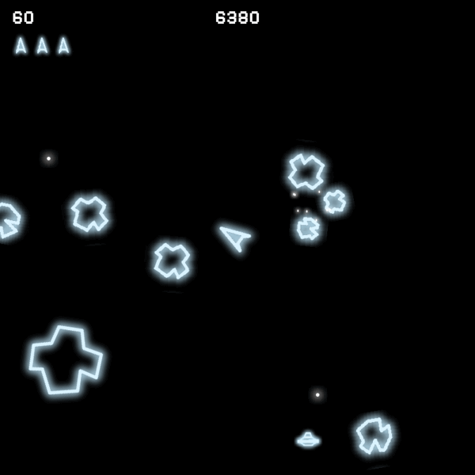

# Asteroids

A remake of the 1979 Atari arcade game, written in C++20 on a small home-made engine
(SDL2 + Lua). It's one step of a learning roadmap — each game is harder than the last and
pushes the engine further:

> Tetris → Arkanoid → **Asteroids** → Pac-Man → Mario → Wolfenstein 3D → DOOM



## Gameplay

Close to the arcade rules:

- **Waves** of 4, 6, 8, 10 and then 11 large asteroids. A hit splits a large asteroid into two
  medium ones, a medium into two small ones; small ones just break.
- **Points:** large asteroid 20, medium 50, small 100, large saucer 200, small saucer 1000.
- **Lives:** 3, plus one every 10,000 points. A new ship only appears when the middle of the
  screen is free of asteroids and saucers.
- **Flying saucers:** the large one shoots in random directions, the small one aims at you —
  more accurately, and more often, the higher your score. Their shots also break asteroids
  (but those don't score for you).
- **Bullets:** at most 4 on screen, like the arcade.
- **Hyperspace:** jump to a random place. About one jump in eight goes wrong.
- **High score**, saved between runs (on Linux in `~/.local/share/smo0115/Asteroids/`).
- The original sounds, including the "heartbeat" that speeds up the longer a wave lasts.

### Controls

| Key            | Action                                   |
|----------------|------------------------------------------|
| ← / →          | Turn                                     |
| ↑              | Thrust                                   |
| Space          | Fire                                     |
| ↓              | Hyperspace                               |
| Esc            | Pause / resume (game over: back to title) |
| Enter          | Start a game                             |

## Building

You need **CMake 3.25+** and a **C++20 compiler** (GCC or Clang). Every library is downloaded and
built by CMake (FetchContent), pinned to a fixed version:

SDL2, SDL_image, SDL_ttf, SDL_mixer, Lua 5.4, sol2, yyjson, GLM, spdlog, GoogleTest.

SDL needs the system's window and audio headers to build its backends. On Debian/Ubuntu, the CI
installs these packages first:

```sh
sudo apt-get install libsdl2-dev libsdl2-image-dev libsdl2-mixer-dev libsdl2-ttf-dev
```

Then:

```sh
cmake -S . -B build -DCMAKE_BUILD_TYPE=Debug
cmake --build build --parallel
```

The first configure downloads and builds all dependencies, so it takes a while.

### Running

The game loads `assets/...` relative to the **working directory**. The build copies `assets/` next
to the executable, so either of these works:

```sh
cd build/src/game && ./Asteroids
./build/src/game/Asteroids          # from the repository root
```

### Tests

```sh
ctest --test-dir build
```

The unit tests (GoogleTest) cover the engine: collision, scene pools, the service context, the Lua
component bindings and object lifetimes.

### Sanitizers

```sh
cmake -S . -B build-asan -DCMAKE_BUILD_TYPE=Debug -DASTEROIDS_SANITIZE=ON
```

builds our own targets with AddressSanitizer and UndefinedBehaviorSanitizer.

### manage.py

A small helper that does the same steps (it's also what the CI runs):

```sh
python3 manage.py configure   # CMake configure into build/ (Ninja)
python3 manage.py build
python3 manage.py run
python3 manage.py test
python3 manage.py format      # clang-format all .cpp files (the CI fails on unformatted code)
python3 manage.py analyze     # clang-tidy
```

## Project layout

```
src/engine/    the engine: reusable, knows nothing about Asteroids
src/game/      the game, built on the engine
src/sandbox/   an empty second app, to prove the engine stands on its own
tests/         unit tests for the engine
assets/        sprites, sounds, fonts and the Lua scripts
docs/          README images
```

The engine must never include game code. CMake checks this: configuring fails if a file in
`src/engine` includes anything from `src/game` or `src/sandbox`.

## How it works

**Context.** One object that owns all services (renderer, sound, scene, event bus, systems, ...).
Everything is reached through it — `ctx.get<RenderSystem>()` — instead of through singletons.
Services are destroyed in reverse order of registration, so a service can rely on the ones before it.

**Scene, components, systems.** A `GameObject` is a bag of components (plain data: `Transform`,
`Physics`, `Collider`, `Sprite`, ...). The scene keeps objects in pools (`Player`, `Enemies`,
`Bullets`, ...). Systems hold the logic and run over the objects that have the components they need.

**Fixed time step.** The game logic runs at exactly 120 ticks per second, however fast the screen
refreshes; a frame runs as many ticks as the time that passed. So the game plays the same on every
machine.

**Events.** Systems talk through an `EventBus`, cleared at the end of every tick. One tick of the game:

1. `CollisionSystem` finds overlapping circles → `CollisionEvent`
2. `CombatSystem` destroys both objects of each collision → `AsteroidDestroyed`, `SaucerDestroyed`, `ShipDestroyed`
3. `PlayerSystem` (keys, respawn, hyperspace) and `SaucerSystem` (flying, shooting)
4. `SessionSystem` (score, lives) and `EffectsSystem` (explosions, bangs) react to the events
5. `WaveSystem` starts the next wave when the sky is empty
6. physics, screen wrap, lifetimes, animation
7. `SoundSystem` plays everything that was asked for in this tick

Objects are never deleted in the middle of a tick: `destroy()` only marks them, and the engine
erases them after the tick, when no event points at them anymore.

**Lua.** What an object is made of lives in `assets/scripts/prefabs.lua` (`SpawnAsteroid`,
`SpawnSaucer`, ...); C++ decides when and where to spawn. The engine knows no component, layer or
state names — the game registers them before the scripts run.

**Game states.** Title → Run ⇄ Pause → Game over → Run again (or back to the title).

## Credits

- Sprites: *Asteroids sprites* by Joe Strout, https://miniscript.org
- Font: Pixelify Sans (Google Fonts)
- Sounds: https://classicgaming.cc
